<div align="center">
  
</div>

# DataBridge - Customer Data Management Platform

A web application for importing customer spreadsheets without trusting them blindly. It takes a CSV
or Excel file, stages every row, maps the file's columns to customer fields, validates the rows,
compares them with existing customers, and saves nothing until a person has reviewed each row and
committed the batch. Every decision is recorded in an audit trail.

ASP.NET Core on .NET 10 · Blazor Interactive Server · EF Core and SQL Server 2022 · Hangfire
background jobs · ASP.NET Core Identity · optional OpenAI filter search · Docker Compose.


**Try it locally:** start the stack with [Docker Compose](#run-with-docker-compose), open
<http://localhost:8088/>, and choose **Try as guest**. No account is needed.

<p align="center">
  <a href="docs/screenshots/landing-light.png">
    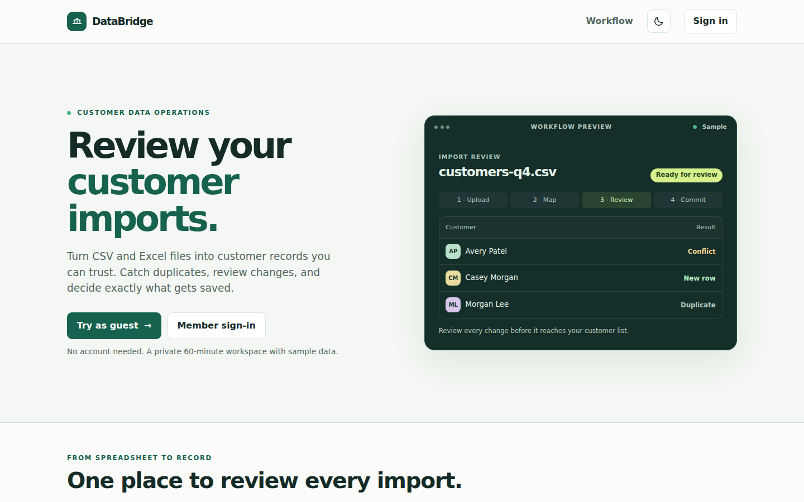
  </a>
</p>

## Table of contents

- [Overview](#overview)
- [Key features](#key-features)
- [Engineering highlights](#engineering-highlights)
- [System architecture](#system-architecture)
- [Import lifecycle](#import-lifecycle)
- [Background jobs and recovery](#background-jobs-and-recovery)
- [AI search pipeline](#ai-search-pipeline)
- [Guest workspace](#guest-workspace)
- [Technology stack](#technology-stack)
- [Security and privacy](#security-and-privacy)
- [Screenshots](#screenshots)
- [Testing strategy](#testing-strategy)
- [Measured results](#measured-results)
- [API reference](#api-reference)
- [Run with Docker Compose](#run-with-docker-compose)
- [Local development](#local-development)
- [Configuration](#configuration)
- [Project structure](#project-structure)
- [Known limitations](#known-limitations)
- [Future improvements](#future-improvements)
- [Authors](#authors)

## Overview

DataBridge answers one question: *which rows in this file should actually change my customer
records?*

An Admin or guest uploads a `.csv` or `.xlsx` file. The API saves the file and a job record together,
returns `202`, and a Hangfire job parses the rows into a staging table. The user maps file headers to
customer fields, and a second job validates every row and compares it with existing customers by
normalized email. Each valid row becomes **New**, **Duplicate**, or **Conflict**, and invalid rows
list their issues. A reviewer approves, rejects, or corrects each row. Once every row has a decision,
an Admin or guest commits the batch, which saves the approved inserts and updates in one transaction.

It is one deployable ASP.NET Core application. Controllers hold HTTP handling, services hold business
rules, and the Blazor pages call the same HTTP API that outside clients use. SQL Server stores the
application data, the uploaded files, the Identity tables, and the Hangfire queue.

## Key features

- **CSV and Excel import** — up to 5 MiB by default, with original cells kept exactly as uploaded and
  source row numbers that match the file.
- **Column mapping** — file headers are matched to customer fields automatically when the names
  match, and can be changed before review starts.
- **Validation and matching** — required fields, email and phone formats, status values, maximum
  lengths, repeated emails within a file, and comparison with existing customers.
- **Row-by-row review** — conflicts show current and incoming values side by side, invalid rows can
  be corrected in place, and a rejection needs a reason.
- **All-or-nothing commit** — approved rows are saved together, with a summary of inserted, updated,
  and rejected rows.
- **Audit history** — validations, corrections, approvals, rejections, withdrawn approvals, customer
  inserts and updates, and commits, with who did them and when.
- **Customer directory** — paged list with location and status filters.
- **Optional AI search** — plain-English questions become validated search filters. Manual search
  works without it.
- **Role-based access** — Admin, Reviewer, Viewer, and Guest roles, enforced by the API.
- **Guest workspace** — a private, temporary workspace with sample data and a sample file.
- **Night mode** — a sun/moon toggle in both headers. It follows the system setting until the visitor
  chooses, and applies the saved choice before the page paints.

## Engineering highlights

- **The file and its work are saved before queueing.** Upload writes the file, batch, and job record
  to SQL Server first, then enqueues a Hangfire job that carries only the batch ID. If queueing fails,
  the work is still saved, and a recurring job queues it within a minute.

- **Jobs are safe to replay.** Parsing saves rows in groups of 500 and skips rows an earlier attempt
  already saved. A unique index on batch and source row number is the final guard, and validation
  results save in one transaction. In the recovery tests, jobs killed partway through finished with
  every row and 0 duplicates.

- **One job per batch, with a lock that can't get stuck.** `ImportJobRunner` takes a SQL Server
  `sp_getapplock` session lock on a dedicated unpooled connection. SQL Server releases it if the
  process dies, so a crash can't leave a batch locked.

- **Old job results can't overwrite newer work.** A run number stops an older job from writing
  progress over a newer one. A `RowVersion` check on the batch rejects a validation save if a reviewer
  changed something first, and those results are discarded.

- **Approvals expire when their facts change.** An approval stores a snapshot of the row and, for
  updates, the customer's `RowVersion` that the reviewer saw. If the row or customer changes,
  revalidation withdraws the approval with an audit entry, and commit returns `409` rather than saving
  over newer data.

- **Commit is transactional and idempotent.** Inserts, updates, audit entries, and the batch status
  commit together. Repeating a commit, or losing a race with another commit, returns the same saved
  summary. In the recovery test, 8 concurrent commits plus 1 repeat added the 20 customers once.

- **Blank cells never erase data.** `FindChanges` is the one place that decides what an update
  changes, and both the conflict preview and the commit use it, so the reviewer sees what gets saved.
  A blank or unmapped cell has no draft value and leaves the customer's value alone.

- **Careful file parsing.** Header rows are checked for blank and ambiguous names. CSV parsing rejects
  an unclosed quote rather than silently swallowing the rows after it, and catches renamed binary
  files. Excel files have an unpacked-size limit to stop zip bombs, keep leading zeros by reading the
  displayed text, and are rejected if a formula has no saved result, rather than reading it as blank.

- **Workspace isolation at the query level.** Customer and import tables have EF Core global query
  filters on the workspace ID. A guest's request can't see another workspace's rows unless code
  explicitly opts out, and another workspace's batch returns `404`.

- **Sign-out takes effect everywhere.** The security stamp is validated on every request, and signing
  out changes it, so every copy of a member's cookie stops working at once. That includes the copy
  open Blazor pages send to the API.

- **The model's answer is treated as untrusted input.** OpenAI is asked for a strict JSON schema, but
  `CustomerAiFilterParser` still checks every field in C#, and any problem rejects the whole reply. The
  result can only fill the filters of the normal read-only customer search.

- **Secrets live outside the image.** Compose mounts secrets as files, and each file name is a setting
  name. `.dockerignore` and `.gitignore` both exclude them, and the admin's bootstrap password file can
  be deleted once the account exists.

- **Migrations run once, before the app.** The Compose `migrate` service runs the same image with
  `--apply-migrations` and exits. `app` starts only after it succeeds.

## System architecture

The browser talks to one ASP.NET Core process. Blazor pages run on the server and call the app's own
controllers over HTTP, sending the signed-in browser's cookie and antiforgery token.

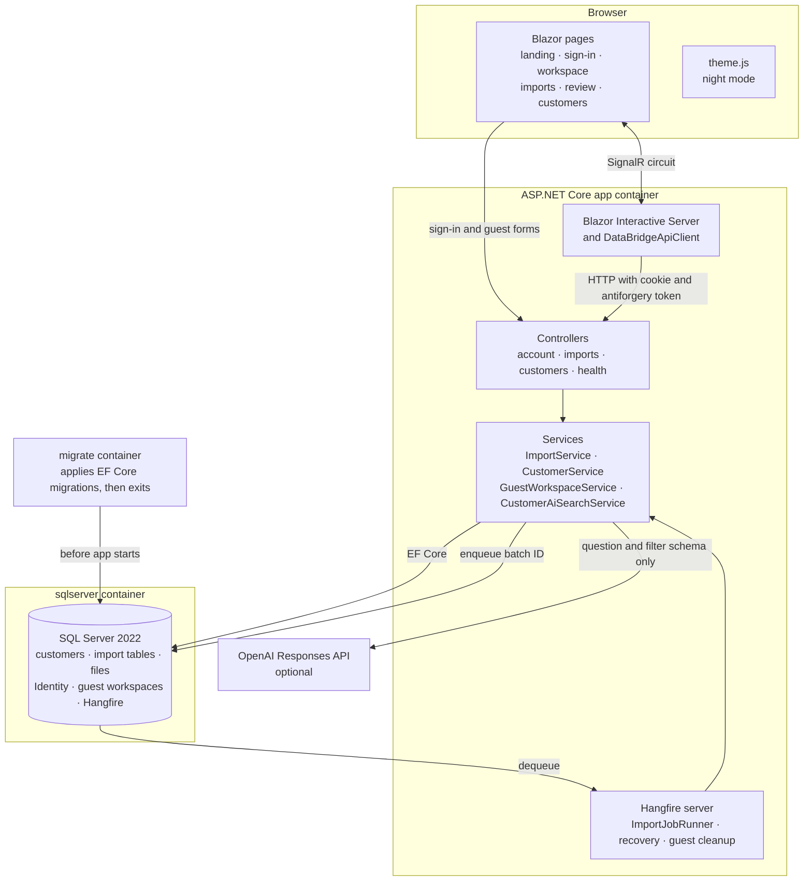

Compose enforces the startup order:

1. `sqlserver` starts and passes its health check.
2. `migrate` applies the EF Core migrations, then exits.
3. `app` starts with Hangfire and Identity, and creates the roles and first admin.

## Import lifecycle

A batch moves through four statuses: `Pending`, `Uploaded`, `ReadyForReview`, and `Committed`.

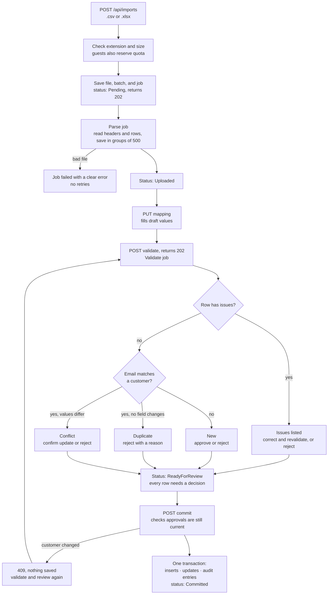

Validation rules:

| Field | Rule |
|---|---|
| Name | Required, up to 200 characters |
| Email | Required, valid format, up to 320 characters, and not repeated in the batch |
| Status | Required, `Active` or `Inactive` |
| Phone | Optional, 7 to 15 digits, using only digits, spaces, a leading `+`, and `( ) . -` |
| Company, Location, Notes | Optional, up to 200, 200, and 2,000 characters |

Roles decide who can do what. The API makes the real check, and the pages only hide what a role can't
use.

| Action | Admin | Reviewer | Viewer | Guest |
|---|:--:|:--:|:--:|:--:|
| View and search customers | ✓ | ✓ | ✓ | ✓ |
| View batches, rows, and audit history | ✓ | ✓ | | ✓ |
| Validate, correct rows, and decide on rows | ✓ | ✓ | | ✓ |
| Upload, save mapping, and commit | ✓ | | | ✓ |

## Background jobs and recovery

Hangfire stores its queue in SQL Server, in its own `HangFire` schema, so jobs survive restarts. A job
that hits a temporary failure retries after 10, 30, and 60 seconds. A bad file fails immediately,
because retrying can't fix it.

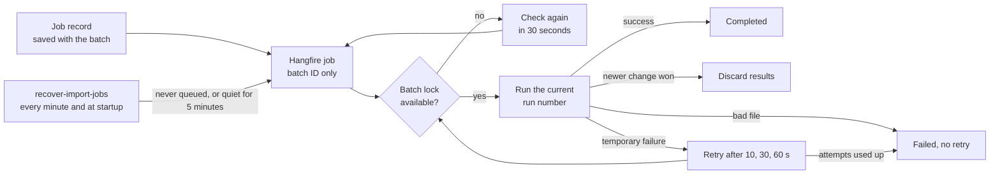

Two recurring jobs run alongside the import jobs:

- `recover-import-jobs` runs every minute and at startup. It queues unfinished work that was never
  queued or hasn't updated for 5 minutes.
- `delete-expired-guest-workspaces` runs hourly and removes expired guest data.

## AI search pipeline

AI search is optional and read-only. It converts a question into filters, and the normal customer
search runs those filters. Without an API key, the app still runs and suggests the manual filters.

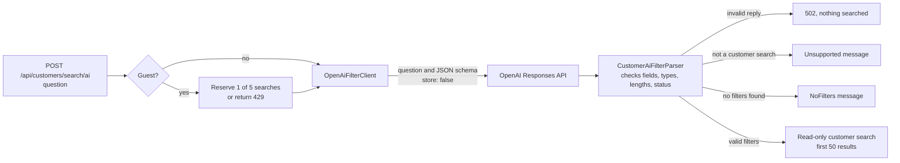

The client sends only the question and the filter schema. Customer records are not sent, but whatever
someone types in the question is. The default model is `gpt-6-astra`, set with `OPENAI_MODEL`. A failed
request returns `503`, and the system prompt tells the model to treat the question as data and ignore
instructions inside it.

## Guest workspace

**Try as guest** exchanges a two-minute, single-use token for a 60-minute browser session. Each session
starts with its own 3 sample customers and can use **Import sample file** to try mapping, validation,
review, and commit. Member records and other guest workspaces are separate.

| Limit | Value |
|---|---|
| Session length | 60 minutes |
| Entry token lifetime | 2 minutes, single use, stored only as a SHA-256 hash |
| Imports per workspace | 5 |
| File size | 1 MiB, unpacking to at most 8 MiB for Excel |
| Data rows per file | 200 |
| AI searches per workspace | 5, when OpenAI is configured |
| Token requests and redemptions | 16 per 5 minutes per IP address |

**Exit guest** ends the session, and a copied cookie stops working too. A background job removes expired
guest data after a one-hour grace period.

## Technology stack

Application:

| Concern | Technology | Purpose |
|---|---|---|
| Framework | ASP.NET Core on .NET 10 | One app for pages, API, and background work |
| UI | Blazor Interactive Server | Server-rendered interactive pages; public pages are static |
| API | MVC controllers | HTTP handling, role checks, and problem responses |
| Styling | Plain CSS with theme variables | `wwwroot/app.css`, in light and night themes |
| Auth | ASP.NET Core Identity | Password sign-in, roles, lockout, and cookies |
| Rate limiting | ASP.NET Core rate limiter | Guest entry limit per IP address |

Data and background work:

| Concern | Technology | Purpose |
|---|---|---|
| Database | SQL Server 2022 | Application data, uploaded files, Identity, and job queue |
| ORM / migrations | EF Core 10 | Data access, query filters, concurrency tokens, and migrations |
| Background jobs | Hangfire 1.8 with SQL Server storage | Parsing, validation, recovery, and guest cleanup |
| CSV parsing | CsvHelper | Reads `.csv` uploads |
| Excel parsing | ClosedXML | Reads `.xlsx` uploads |
| AI search | OpenAI Responses API | Strict JSON filter output, called with `HttpClient` |

Infrastructure and testing:

| Concern | Technology | Purpose |
|---|---|---|
| Containers | Docker, multi-stage build | Published app in the `aspnet:10.0` image, running as a non-root user |
| Orchestration | Docker Compose | SQL Server, migrations, and the app, with health checks |
| API and recovery checks | Python 3 standard library | Scripts in `checks/` against a running stack |
| Browser checks | Playwright with Chromium, Pillow | Real-browser test of night mode and the guest flow |
| Manual requests | `DataBridge.http` | Example HTTP requests |

## Security and privacy

Only mechanisms present in the code are listed here.

- **Sign-in protection.** Passwords need at least 12 characters, with upper case, lower case, a digit,
  and a symbol. An account locks after 5 failed attempts, and sign-in only redirects inside the site.
- **Immediate session revocation.** The security stamp is checked on every request, so sign-out and role
  changes apply at once. Guest cookies are checked against the workspace's expiry on every request.
- **Antiforgery on every write.** A global filter validates the token on every `POST`, `PUT`, and
  `DELETE`, including uploads and sign-in.
- **Authorization in the API.** Controllers enforce roles, and API callers get a `401` or `403` with a
  problem response rather than a redirect.
- **Per-user API calls.** The server-side HTTP client disables its shared cookie store, so one user's
  session can't be sent with another user's request.
- **Guest isolation.** Global query filters scope customer and import data to the workspace. Guest entry
  tokens are single use and stored only as hashes, and redemption can only succeed once under
  concurrent requests.
- **Upload limits.** The API checks the file extension, file size, row count for guests, and unpacked
  workbook size.
- **Limited OpenAI data.** Only the question and the filter schema are sent, with `store: false`. The
  API key stays in server configuration, and replies are validated before use.
- **Secrets outside Git and images.** `secrets/` is excluded by `.gitignore` and `.dockerignore`, and
  secrets are read as files when containers start.
- **Small network exposure.** Compose publishes the app on `127.0.0.1` only and doesn't publish SQL
  Server to the host. The app container runs as a non-root user, and the Hangfire dashboard isn't
  exposed.

## Screenshots

These are captured from the running Compose stack by `checks/theme_browser.py`. The
[screenshot and test results page](docs/README.md) has every screen, including sign-in and the full
import review, with the commands and results. Click any screenshot to open it at full resolution.

### Guest dashboard

The starting point for a guest: the sample import, customer and batch counts, and recent imports.

| Light | Dark |
|---|---|
| <a href="docs/screenshots/guest-dashboard-light.png">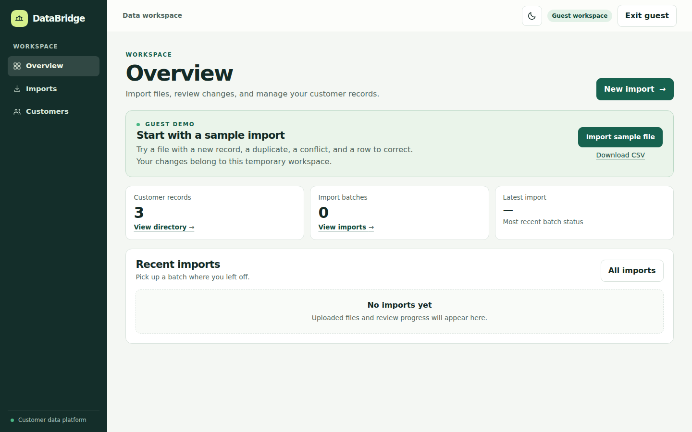</a> | <a href="docs/screenshots/guest-dashboard-dark.png">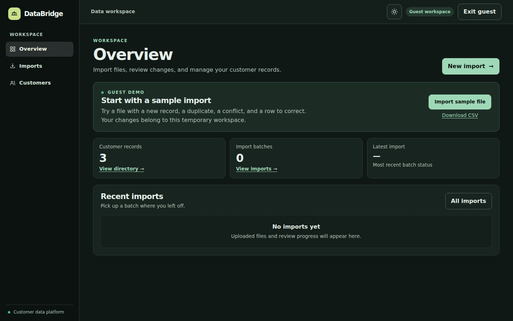</a> |

### Import review

Each row shows its match result and decision. A conflict lists current and incoming values before an
update is approved.

| Light | Dark |
|---|---|
| <a href="docs/screenshots/import-review-light.png">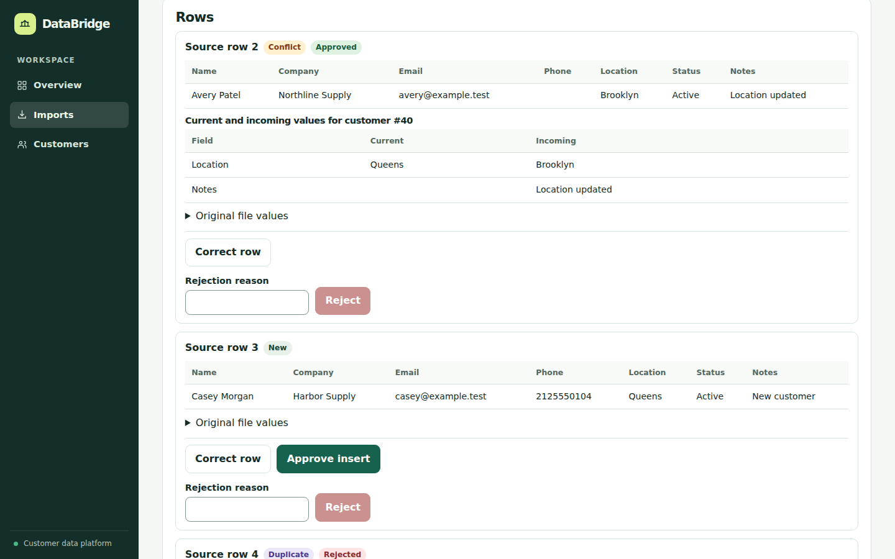</a> | <a href="docs/screenshots/import-review-dark.png">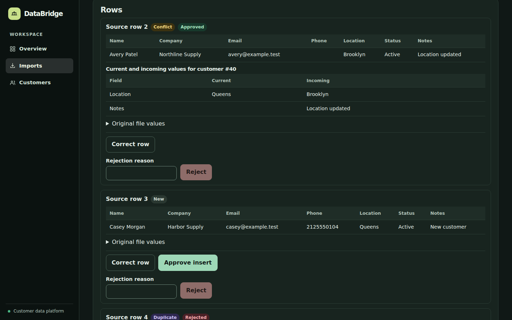</a> |

### Customers

The directory after the commit, with AI-assisted search and manual filters above it.

| Light | Dark |
|---|---|
| <a href="docs/screenshots/customers-light.png">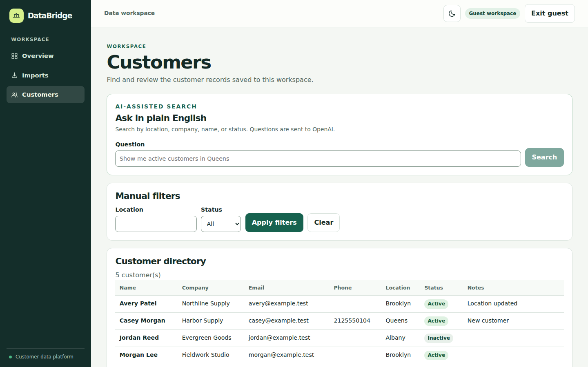</a> | <a href="docs/screenshots/customers-dark.png">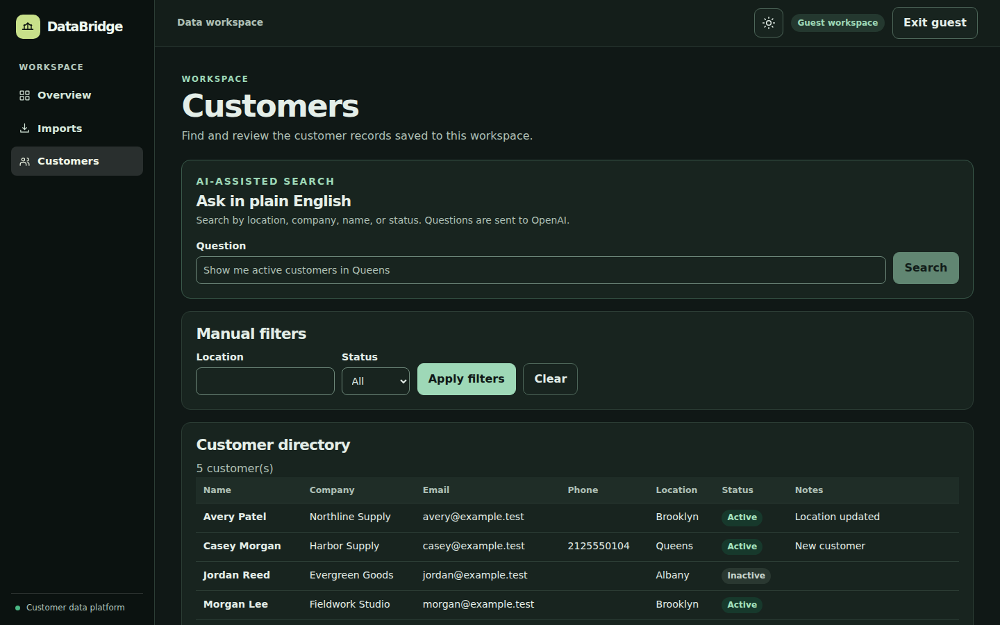</a> |

### Mobile

| Light | Dark |
|---|---|
| <a href="docs/screenshots/guest-dashboard-mobile-light.png">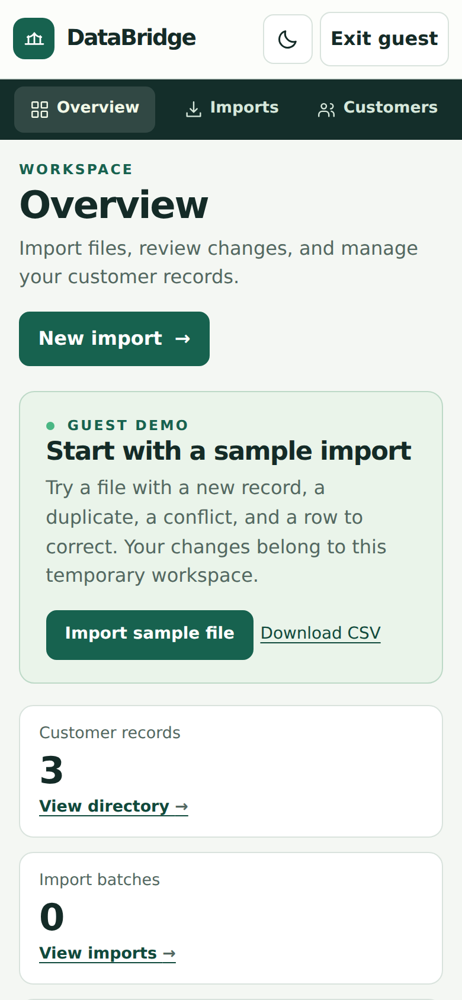</a> | <a href="docs/screenshots/guest-dashboard-mobile-dark.png">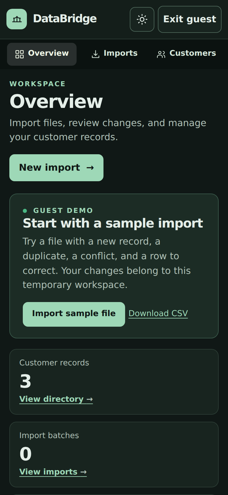</a> |

## Testing strategy

There is no .NET unit test project. Testing is done by scripts that run against the real app and a real
SQL Server, using synthetic data. Run them from the repo root with Python 3 and a running stack.
`import_10k.py`, `recovery.py`, and `guest_access.py` also need the admin password file to still exist.

| Check | What it covers |
|---|---|
| `checks/import_10k.py` | 10,000 rows through the API, with timings and counts |
| `checks/recovery.py` | 10 recovery scenarios; stops and restarts containers |
| `checks/run_ai_eval.sh mock` | 30 AI questions in a throwaway stack with a fake OpenAI server |
| `checks/guest_access.py` | Single-use entry, workspace isolation, and guest exit |
| `checks/theme_browser.py` | Night mode and the full guest flow in Chromium; rewrites the screenshots |

```bash
python3 checks/import_10k.py
python3 checks/recovery.py
checks/run_ai_eval.sh mock
python3 checks/guest_access.py
```

These add test data to the running stack, so use a separate project, such as
`COMPOSE_PROJECT_NAME=databridge-verify`, and remove it afterwards with `docker compose down -v`.

`theme_browser.py` needs Playwright, so its [setup and latest results](docs/README.md#commands) are on
the screenshots page.

**Live AI suite (pending, no key has been available):**

```bash
OPENAI_API_KEY='<your-key>' checks/run_ai_eval.sh live
```

It makes 30 OpenAI calls, which cost money, and prints the model the API reported and the pass count.

**Continuous integration.** This repository has no CI workflow, so these checks are run by hand and
there is no status badge.

## Measured results

Measured on 2026-11-05 in a GitHub Codespace (2 CPUs, 7 GB of memory) with SQL Server 2022 in Compose,
from a clean copy of the files Git would track. These are one run on a shared machine, not a benchmark.

**Startup from a fresh checkout:** 92 seconds including the image build. Order: SQL Server healthy,
migrations applied (`migrate` exited 0 after about 5 seconds), then the app healthy.

**10,000-row import through the API** (9,700 new, 100 exact duplicates, 100 conflicts, 100 invalid):

| Stage | Seconds | Actual counts |
|---|---:|---|
| Upload accepted (202) | 0.14 | Batch created |
| Parse and stage (job) | 9.22 | **10,000 staged**, 0 duplicate source rows |
| Save mapping | 2.57 | 10,000 drafts filled |
| Validate (job) | 8.06 | **10,000 validated:** 9,700 new, 100 duplicates, 100 conflicts, 100 with issues |
| Read review preview | 3.54 | 10,000 rows read over 100 pages |
| Review all rows | 127.09 | 10,000 requests: 9,800 approved, 200 rejected |
| Commit | 8.83 | **9,700 inserted, 100 updated**, 200 rejected |
| **Total** | **159.45** | Customers 202 to 9,902; 19,802 audit entries |

All 100 updated customers kept their existing note when the incoming cell was blank.

**Recovery scenarios: 10 of 10 passed**

| # | Scenario | Result |
|---|---|---|
| 1 | CSV job killed | Killed at 4,500 of 30,000 rows; finished 71 s after restart with 30,000 rows, 0 duplicates |
| 2 | Excel job killed | Killed at 3,500 of 30,000 rows; finished 70 s after restart with 30,000 rows, 0 duplicates |
| 3 | Saved work that wasn't queued | No Hangfire job while the app was down; recovery queued it, and it finished with 50 rows |
| 4 | Duplicate job delivery | Second delivery during the job, then a replay: 20,000 rows, 0 duplicates |
| 5 | Temporary database failure | SQL Server killed at 4,000 of 30,000 rows for 15 s; the job failed once and was retried; 30,000 rows, 0 duplicates |
| 6 | Permanently invalid file | Failed with a clear error, 0 retries, 0 rows; mapping returns 409 |
| 7 | Newer mapping during validation | Old results discarded; drafts use the new mapping |
| 8 | Commit rollback | Forced failure: 500, no customers or audit entries saved; the retry committed 20 |
| 9 | Repeated and concurrent commit | 8 at once plus 1 repeat: same summary, 20 customers added, 1 commit entry |
| 10 | Customer changed after approval | Commit returned 409 with nothing saved; validating cleared the approval; re-approval kept the newer note |

**AI reference questions (30: 18 searches, 6 clarifications, 6 rejections)**

| Suite | Model | Result |
|---|---|---|
| Mocked | `mock-model` (fake server) | **30 of 30** |
| Live | Not run | **Pending:** no OpenAI key has been available |

The mocked suite returns the expected answer for each question, so it proves the app's request,
validation, query, and results, not a model's judgment. With its answers deliberately broken, the same
suite failed all 18 searches, which confirms it can detect wrong results.

**Browser test against the Compose stack:** sign-in, Excel upload, mapping, validation, approval and
rejection, commit, the saved customer on `/customers`, and sign-out all passed, with no browser errors.

**Night mode and guest flow, 2026-11-06:** `checks/theme_browser.py` passed 87 of 87 checks in Chromium.
See the [full results](docs/README.md#test-results).

## API reference

Examples are in [`DataBridge.http`](DataBridge.http). Writes need the antiforgery token in the
`X-CSRF-TOKEN` header. Paged endpoints take `page` and `pageSize`, with up to 100 items per page.

| Method | Path | Roles | Description |
|---|---|---|---|
| `GET` | `/api/health` | none | Returns `{"status":"Healthy"}` |
| `GET` | `/api/account/antiforgery` | none | Issues an antiforgery token for API clients |
| `POST` | `/account/login` | none | Form sign-in; redirects |
| `POST` | `/account/logout` | signed in | Signs out and ends other copies of the session cookie |
| `POST` | `/account/guest-token` | none | Issues a single-use guest token; rate limited |
| `POST` | `/account/guest` | none | Redeems the token and starts a guest session; rate limited |
| `GET` | `/api/customers` | any | Paged customers, filtered by `location` and `status` |
| `POST` | `/api/customers/search/ai` | any | Turns a question into filters and searches; guests get 5 |
| `POST` | `/api/imports` | Admin, Guest | Multipart upload; returns `202` |
| `GET` | `/api/imports` | Admin, Reviewer, Guest | Paged batches |
| `GET` | `/api/imports/{batchId}` | Admin, Reviewer, Guest | One batch with its job progress |
| `GET` | `/api/imports/{batchId}/rows` | Admin, Reviewer, Guest | Paged rows with issues and field changes |
| `PUT` | `/api/imports/{batchId}/mapping` | Admin, Guest | Saves the column mapping and fills drafts |
| `POST` | `/api/imports/{batchId}/validate` | Admin, Reviewer, Guest | Queues validation; returns `202` |
| `PUT` | `/api/imports/{batchId}/rows/{rowId}` | Admin, Reviewer, Guest | Corrects a row and revalidates the batch |
| `PUT` | `/api/imports/{batchId}/rows/{rowId}/decision` | Admin, Reviewer, Guest | Approves or rejects a row |
| `POST` | `/api/imports/{batchId}/commit` | Admin, Guest | Commits approved rows; repeating returns the same summary |
| `GET` | `/api/imports/{batchId}/audit` | Admin, Reviewer, Guest | Paged audit history |

Import errors use these status codes: `400` invalid request, `404` not found or in another workspace,
`409` locked or out-of-date state, `413` file too large, and `415` unsupported file type.

## Run with Docker Compose

You need Docker with Compose v2. From a fresh checkout:

```bash
./scripts/setup-secrets.sh
printf '%s' 'you@example.com' > secrets/app/Seed__Users__0__Email
printf '%s' 'Admin' > secrets/app/Seed__Users__0__Role
read -rsp 'Admin password: ' p; printf '%s' "$p" > secrets/app/Seed__Users__0__Password; unset p; echo
docker compose up -d --build --wait
```

Open <http://localhost:8088/> and choose **Try as guest** or **Member sign-in**. To use another port,
set `DATABRIDGE_PORT`.

Useful commands:

```bash
docker compose ps -a               # migrate should show Exited (0)
docker compose logs -f app
docker compose down                # stop and keep the data
docker compose down -v             # stop and DELETE this stack's data
```

| Service | Image | Port | Purpose |
|---|---|---|---|
| `sqlserver` | `mcr.microsoft.com/mssql/server:2022-latest` | Not published | Database, limited to 2 GB of memory, with data in the `sql-data` volume |
| `migrate` | `databridge-app:local` | None | Applies the EF Core migrations, then exits |
| `app` | `databridge-app:local` | `127.0.0.1:8088` | The application, health-checked through `/api/health` |

This stack has its own volumes, `databridge_sql-data` and `databridge_data-protection-keys`. It doesn't
touch the `databridge-sql` dev container or its `databridge-sql-data` volume, and it doesn't publish SQL
Server to the host, so both can run together.

### Runtime secrets

Secrets are files in `secrets/`, which Git and Docker builds both ignore. They're read when the
containers start and are never copied into an image.

| File | Purpose |
|---|---|
| `secrets/sql_sa_password` | SQL Server password, generated by `setup-secrets.sh` |
| `secrets/app/<Setting__Name>` | One app setting per file. The file name is the setting and the contents are its value |

**First local admin.** The commands above create it on first start. The password needs at least 12
characters, with upper case, lower case, a digit, and a symbol. Once the account exists, remove the
password file; the app still starts and you can still sign in:

```bash
rm secrets/app/Seed__Users__0__Password
docker compose restart app
```

To add another user, create `Seed__Users__1__Email`, `Seed__Users__1__Password`, and
`Seed__Users__1__Role` (`Admin`, `Reviewer`, or `Viewer`), then restart the app. An existing user is
never changed.

**OpenAI.** AI search is optional, and manual search works without it:

```bash
read -rsp 'OpenAI API key: ' k; printf '%s' "$k" > secrets/app/OpenAI__ApiKey; unset k; echo
docker compose restart app
```

To use another model, set `OPENAI_MODEL` when running `docker compose up`.

## Local development

`dotnet run` uses the `databridge-sql` dev container and .NET user secrets:

```bash
docker start databridge-sql
dotnet ef database update
dotnet run
```

Set the first admin with `dotnet user-secrets set "Seed:Users:0:Email" ...`, plus `Password` and `Role`
in the same way. The connection string is the `ConnectionStrings:DataBridge` user secret, and the app
listens on <http://localhost:5288>.

## Configuration

Compose variables, read from the shell or a `.env` file:

| Variable | Default | Description |
|---|---|---|
| `DATABRIDGE_PORT` | `8088` | Host port on `127.0.0.1` |
| `DATABRIDGE_SECRETS_DIR` | `./secrets` | Folder holding the secret files |
| `OPENAI_MODEL` | `gpt-6-astra` | Model for AI search |
| `COMPOSE_PROJECT_NAME` | `databridge` | Separate project name for running the checks |

App settings. In Compose, use double underscores, either as an environment variable or as a file in
`secrets/app/`. Never commit real values.

| Setting | Required | Description |
|---|---|---|
| `ConnectionStrings__DataBridge` | yes | SQL Server connection. Compose builds it from the password file |
| `Api__BaseUrl` | yes | Address the server uses to call its own API. Compose uses `http://localhost:8080` |
| `Secrets__Directory` | no | Folder of key-per-file settings. Compose uses `/run/secrets/app` |
| `DataProtection__KeysPath` | no | Keeps sign-in cookies valid when a container is replaced. Compose uses `/keys` |
| `Seed__Enabled` | no | Creates the seed users outside Development. Defaults to `false`; Compose sets `true` |
| `Seed__Users__N__Email`, `__Password`, `__Role` | no | Users to create at startup. An existing user is never changed |
| `OpenAI__ApiKey` | no | Without it, AI search reports that it isn't set up |
| `OpenAI__Model` | yes | Set by `appsettings.json` and Compose |
| `OpenAI__BaseUrl` | yes | Defaults to `https://api.openai.com/v1/` |
| `OpenAI__TimeoutSeconds` | no | Defaults to `20` |
| `Import__MaxUploadBytes` | no | Defaults to `5242880` (5 MiB). Guests are limited to 1 MiB regardless |
| `Hangfire__WorkerEnabled` | no | Runs background jobs in this process. Defaults to `true` |

## Project structure

```
DataBridge/
├── Components/
│   ├── Layout/                  Public and workspace layouts, reconnect dialog
│   ├── Pages/                   Home, Login, Workspace, Imports, ImportDetails, Customers
│   ├── Shared/                  ThemeToggle, BrandMark, ImportRowCard, Pager, filters
│   ├── App.razor                Document head, render mode, and antiforgery setup
│   └── Routes.razor             Router and authorization
├── Controllers/                 Account, Imports, Customers, and Health endpoints
├── Data/
│   ├── DataBridgeDbContext.cs   Tables, indexes, and workspace query filters
│   ├── IdentitySeeder.cs        Roles and seed users
│   └── Migrations/              EF Core migrations
├── DTOs/                        Request and response types
├── Interfaces/                  Service contracts
├── Models/                      Entities, statuses, roles, and guest limits
├── Services/
│   ├── ImportService.cs         Upload, parsing, validation, review, commit, and audit
│   ├── ImportJobQueue.cs        Queueing and recovery of import jobs
│   ├── ImportJobRunner.cs       Hangfire job, batch lock, and retries
│   ├── GuestWorkspaceService.cs Guest tokens, sessions, quotas, and cleanup
│   ├── CustomerService.cs       Customer search
│   ├── CustomerAiSearchService.cs, CustomerAiFilterParser.cs, OpenAiFilterClient.cs
│   └── DataBridgeApiClient.cs   HTTP client the Blazor pages use
├── checks/                      API, recovery, AI, guest, and browser checks
├── docs/                        Logo, screenshots, and night mode test results
├── scripts/setup-secrets.sh     Creates the local secrets folder
├── wwwroot/                     app.css, theme.js, guest-entry.js, sample-customers.csv
├── compose.yaml                 SQL Server, migrations, and app
├── compose.mock.yaml            Adds the fake OpenAI server for the AI checks
├── Dockerfile                   Multi-stage build of the app image
├── DataBridge.http              Example API requests
└── Program.cs                   Service setup and the HTTP pipeline
```

## Known limitations

- **Local deployment only.** Compose serves plain HTTP on `127.0.0.1`. There is no production deployment
  configuration, so a public deployment would need TLS and a reverse proxy added first.
- **The live AI suite hasn't run.** AI search has only been verified against a fake OpenAI server, which
  proves the app's handling but not a real model's judgment.
- **No .NET unit tests or CI.** The checks are end-to-end scripts that are run by hand.
- **Files are read into memory and stored in the database.** Uploads are copied into memory and kept as
  binary data in SQL Server after the commit. That's part of why uploads have a 5 MiB default limit.
- **Reviewing is one row at a time.** There's no bulk approval in the UI or API. In the 10,000-row test,
  review was 127 of the 159 seconds.
- **Matching is by email only.** A customer whose email changed is treated as new, and two customers
  can't share an email within a workspace.
- **No customer editing outside imports.** Customers are created and updated only by committing a batch.
  The API has no endpoint to edit or delete one directly, or to delete a batch.
- **No account management screens.** Members are created from seed settings. There's no registration,
  password reset, or role management in the app.
- **Manual filters are limited.** The directory's manual filters cover location and status only. Company
  and name are reachable only through AI search.
- **Sign-in has no IP rate limit.** Account lockout protects individual accounts, and the rate limiter
  only covers guest entry.
- **Night mode was tested in Chromium only.** Firefox, Safari, and physical phones weren't tested.
- **Dependency advisories.** `dotnet build` reports 4 warnings, which are 2 advisories repeated, for
  `System.Security.Cryptography.Pkcs` 9.0.11. It comes through EF Core's SQL Server package
  (`Microsoft.Data.SqlClient`). Adding version 10.0.14 directly cleared both advisories in a scratch
  copy, but that change hasn't been made here.
  - High: <https://github.com/advisories/GHSA-846f-f764-76mx>
  - Moderate: <https://github.com/advisories/GHSA-2fmv-rv2c-59x7>

## Future improvements

- Clear the two dependency advisories by referencing the patched package directly.
- Run the live AI suite with a real key and publish the result.
- Add a CI workflow for the build and the Compose-based checks, and a status badge once it runs.
- Add a .NET unit test project for validation, matching, and the AI filter parser.
- Add bulk review actions, such as approving all new rows.
- Remove stored upload files after a commit, or move them to object storage.
- Add company and name to the manual customer filters.
- Add an IP rate limit to sign-in.
- Add customer editing, password reset, and user management screens.
- Add a production deployment configuration with TLS.
- Run the browser check in Firefox and WebKit.

## Authors

- **Ahmed Ali** — [GitHub](https://github.com/AhmedKamal-41)

---

<div align="center">

[Screenshots and test results](docs/README.md) · [Star this repo](https://github.com/AhmedKamal-41/DataBridge)

</div>
