# Night mode screenshots and test results

Everything here comes from the real app running in Docker Compose, driven by Chromium through Playwright with `checks/theme_browser.py`. Each pair was captured in one guest session with the same sample data, viewport, and scroll position. Only the theme changes.

Desktop shots are 1440×900. Mobile shots are 390×844 at 2× pixel density, so the files are 780×1688.

## Screenshots

### Landing page

| Light | Dark |
|---|---|
| 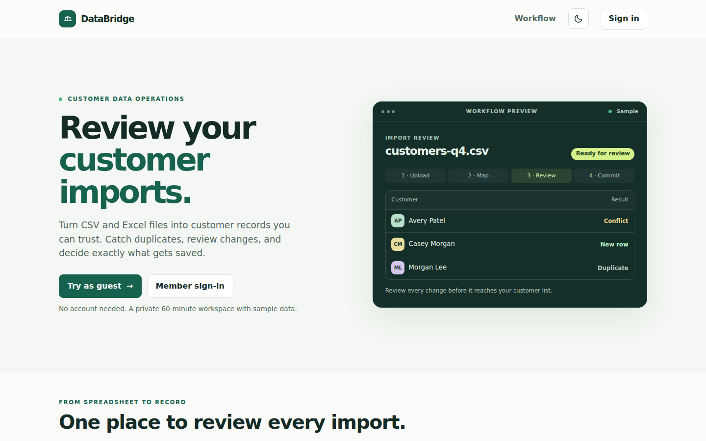 | 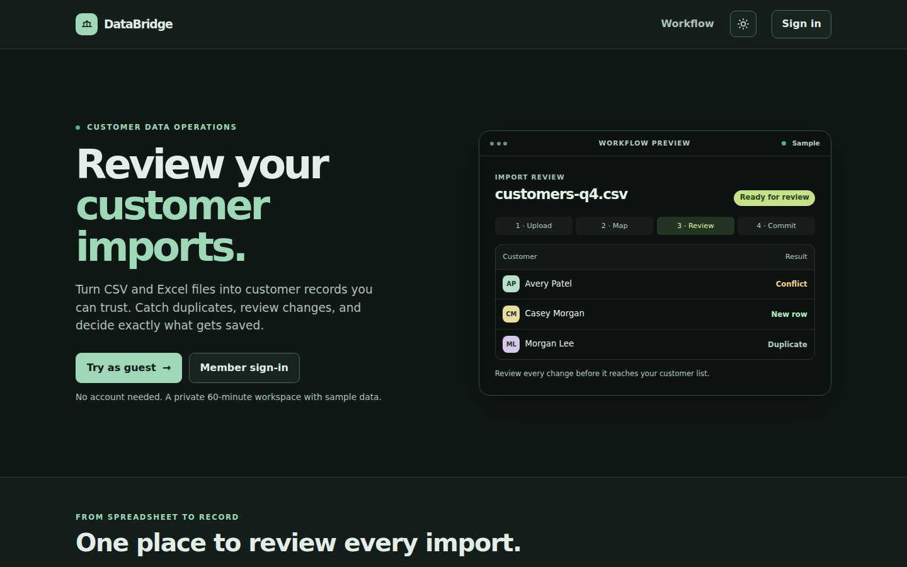 |

### Sign-in

| Light | Dark |
|---|---|
| 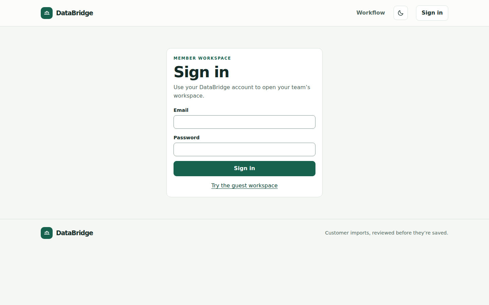 | 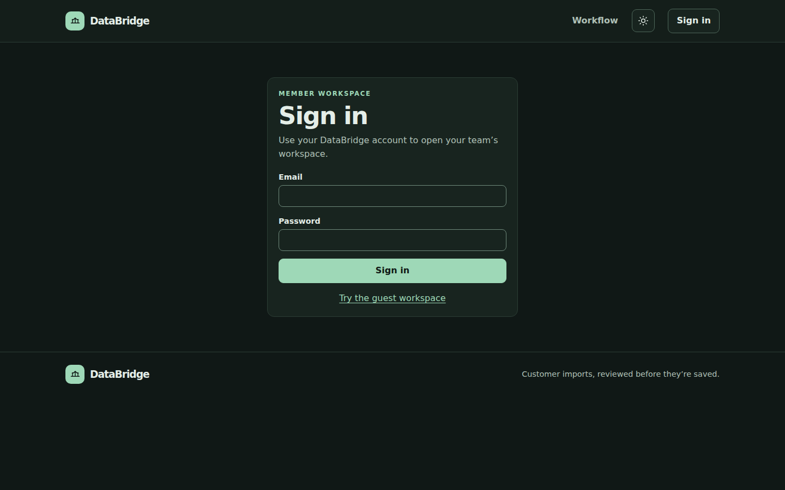 |

### Guest dashboard

| Light | Dark |
|---|---|
| 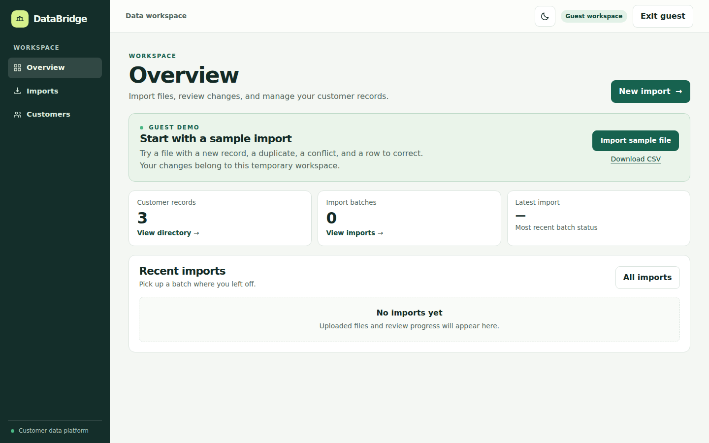 | 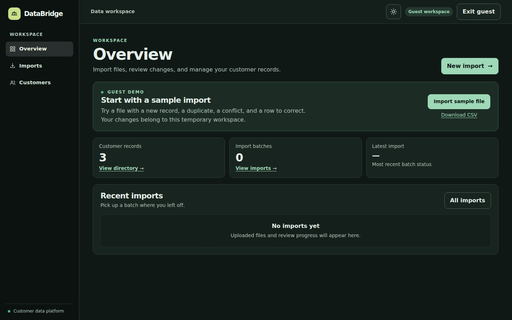 |

### Guest dashboard on mobile

| Light | Dark |
|---|---|
| 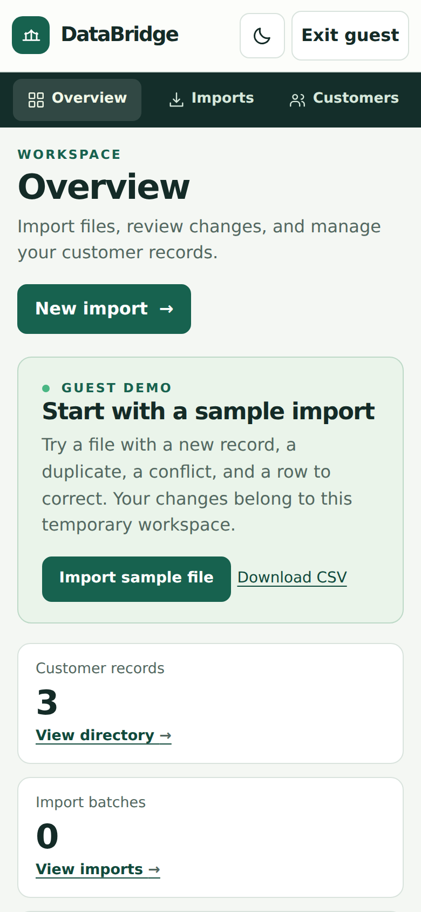 | 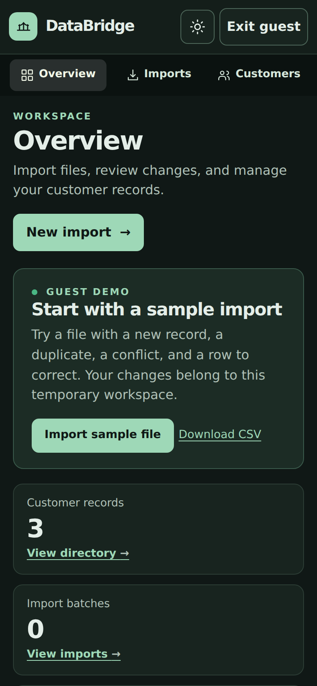 |

### Import review

Scrolled to the rows, with both themes at the same scroll position (862 px).

| Light | Dark |
|---|---|
| 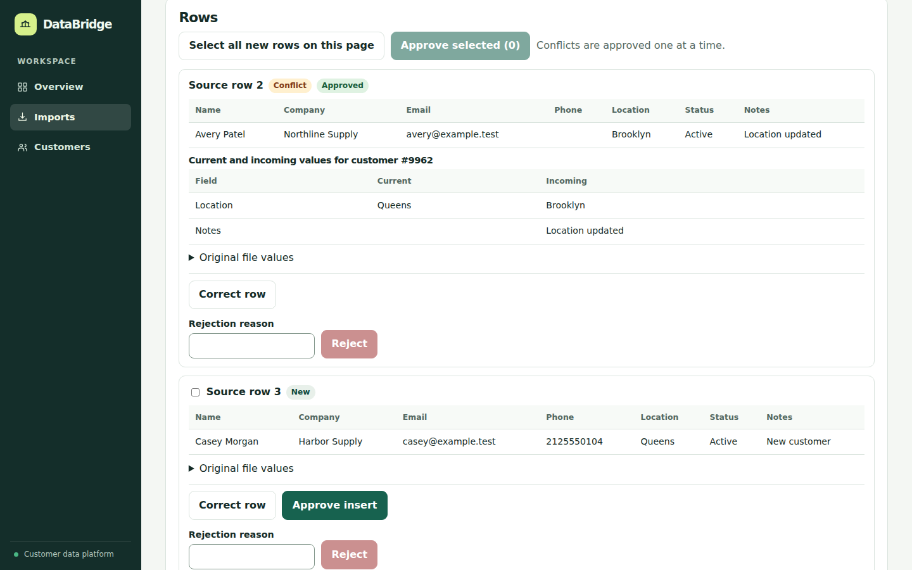 | 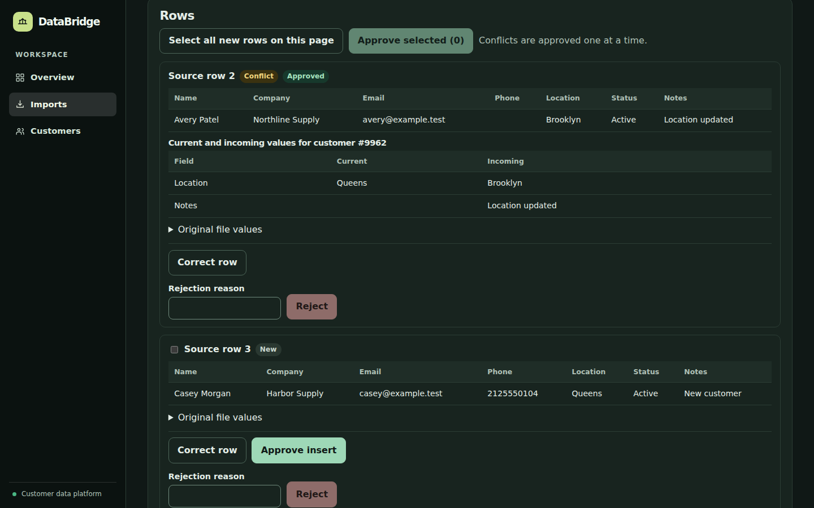 |

The Rows panel alone shows every status together: Conflict, New, Duplicate, an issue, Approved, and Rejected. The root README uses the dark version as its highlight.

| Light | Dark |
|---|---|
| 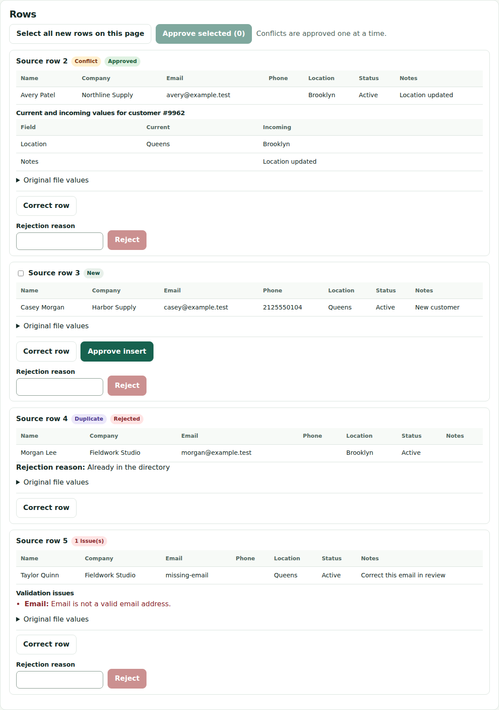 | 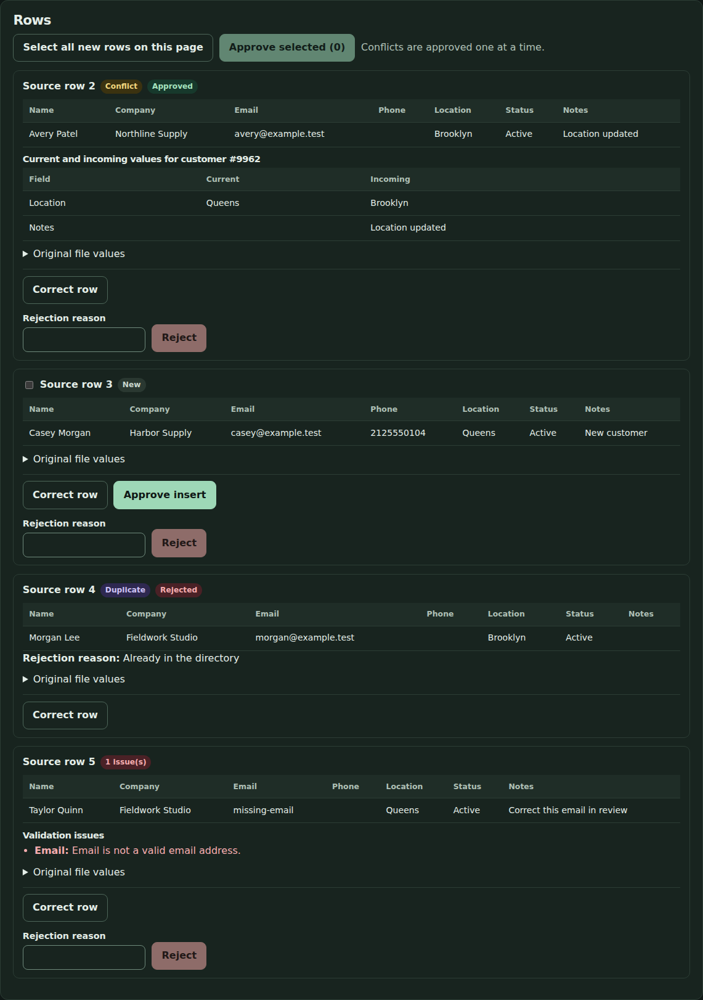 |

The full page also includes mapping, commit, and audit history. The sidebar stops partway down because it's sticky and one screen tall, so this only appears in a full-page capture.

| Light | Dark |
|---|---|
| 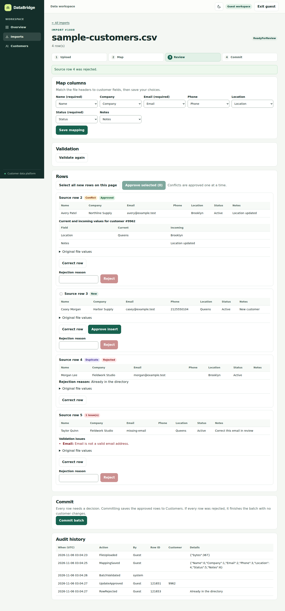 | 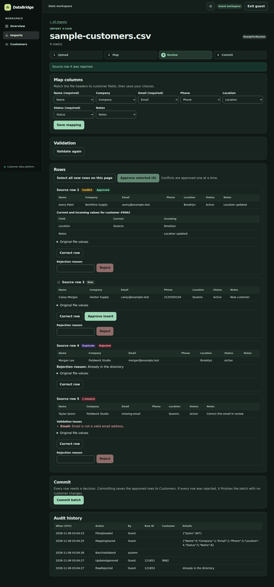 |

### Customers

After the commit: 5 records, made up of the 3 sample customers (Avery Patel updated by the import) and 2 inserted rows.

| Light | Dark |
|---|---|
| 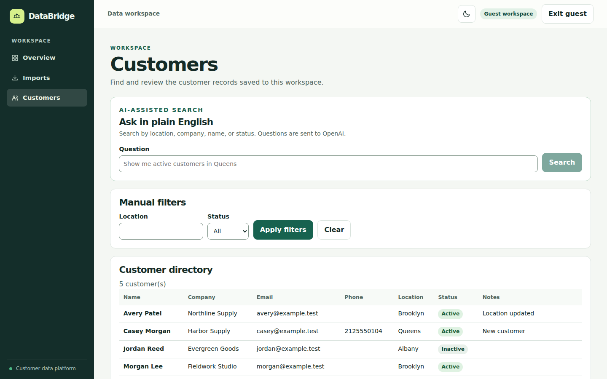 | 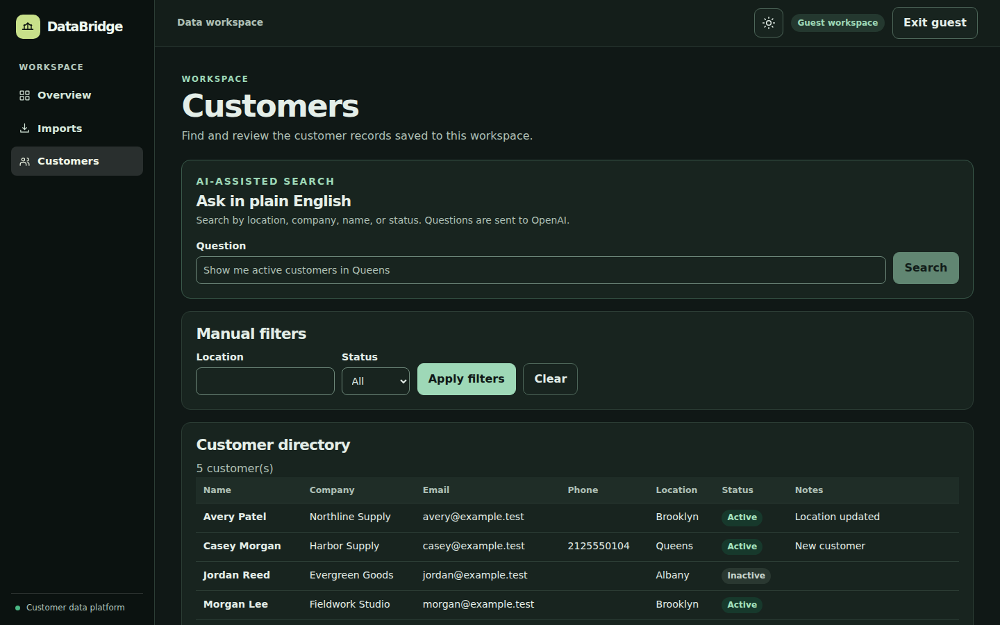 |

## Commands

From the repo root. `setup-secrets.sh` wasn't needed because `secrets/sql_sa_password` already existed.

```bash
test -f secrets/sql_sa_password || ./scripts/setup-secrets.sh
docker compose up -d --build --wait

python3 -m venv ~/databridge-browser        # Outside the repo, so Git and Docker ignore it
~/databridge-browser/bin/pip install playwright pillow
~/databridge-browser/bin/playwright install chromium
~/databridge-browser/bin/python checks/theme_browser.py    # Runs the checks and rewrites docs/screenshots/
```

The other checks run in throwaway stacks, with their own secrets, through the regression script:

```bash
PYTHON=~/databridge-browser/bin/python checks/run_regression.sh
```

## Test results

Run on 2026-11-06 in a GitHub Codespace with Chromium 156.0.8078.4, Playwright 1.64.1, and Pillow 13.0.0. The root README's [Measured results](../README.md#measured-results) has the other regression checks.

| Check | Result |
|---|---|
| `checks/theme_browser.py` | **88 of 88 passed**, exit code 0 |
| `checks/review_browser.py` | **9 of 9 passed**, exit code 0 |
| `checks/guest_access.py` | **3 of 3 passed**, exit code 0 |
| `dotnet build` | 0 errors, 0 warnings |

What `theme_browser.py` covers:

| Area | What was verified |
|---|---|
| First visit | Follows the system light or dark setting, saves nothing, and keeps following the system until the visitor chooses |
| Saved choice | Saved in `localStorage` under `databridge-theme`, overrides the system setting, and survives refresh. An invalid saved value falls back to the system setting |
| No flash | The theme is set before `<body>` is parsed. No light frame appeared while refreshing dark pages with the CPU slowed 4× (brightest corner 26/255). With `theme.js` blocked, the same measurement saw light frames (251/255), so it can detect a flash |
| Keyboard | Tab reaches the toggle with a visible 3 px focus ring, on the public and workspace headers. Enter and Space both switch the theme and keep focus |
| Persistence | Through enhanced navigation to sign-in, Try as guest, workspace navigation, refresh, commit, and Exit guest |
| Guest flow | Landing, Try as guest, Import sample file, suggested mapping, validation (Conflict, New, Duplicate, 1 issue), row review with one correction, commit (2 inserted, 1 updated, 1 rejected), and Customers (5 records) |
| Mobile | Emulated touch phone: tapping switches the theme on the landing page and workspace, and the choice survives navigation and refresh. The toggle is 42 px and fits with no sideways scroll at 320, 360, 390, 430, and 768 px |
| Contrast | Each page in both themes, plus a fixture with every status style, button, and input: text at least 4.5:1 (3:1 for large text), input borders and focus ring at least 3:1. Disabled controls are exempt, as in WCAG |
| Status colours | Conflict, duplicate, error, and success differ clearly in both themes: at least 36 delta E in dark and 20 in light |
| Browser errors | No console errors, page errors, or failed requests |

## Issues found and fixed

| Issue | Fix |
|---|---|
| Duplicate and New badges looked the same in both themes | Added a violet `.badge.duplicate` |
| Light input borders had 1.77:1 contrast | Changed `--input-line` to `#7f9488`, which meets 3:1. This is a small visible change to the light theme |
| Conflict and error badges were too close in dark | Moved amber towards yellow and error towards red |
| The error bar and reconnect dialog would have shown light text on a light background in dark | Set their colours explicitly and through the theme variables |
| The skip link used the theme's text colour on its fixed lime background | Gave it a fixed dark text colour |
| Blazor's enhanced navigation can drop `data-theme` from `<html>` | `theme.js` watches the attribute and restores it |
| On touch screens the toggle stayed highlighted after a tap | Removed its hover fill on devices without hover |
| The dark sidebar's border showed as a stray line at the phone screen's edge | Removed the border at mobile widths |

A pixel comparison with the previous build at 1280 px showed the light theme changed only at the toggle (and the header links it moves), input borders, the Duplicate badge, and per-run import and customer numbers.

## Not covered

- Only Chromium was tested. Firefox and Safari weren't, and mobile is Chromium's device emulation rather than a physical phone.
- `theme_browser.py` doesn't sign in as a member. `review_browser.py` does, but only in the light theme by default.
- AI search wasn't run in the browser. Its error and info messages were only checked through the contrast fixture.
- The error bar and reconnect dialog were checked by their computed colours, not by forcing a real failure.
- Tailwind isn't configured in this checkout, so there were no dark variants to connect.
